<div align="center">

# 💧 Tem Água?

### O mapa colaborativo da falta d'água em Salto/SP

**Abriu a torneira e não saiu nada? Marque no mapa.**<br/>
Seus vizinhos veem na hora — e você descobre se o problema é só na sua casa ou no bairro inteiro.

### 👉 [saltotemagua.victorandra.de](https://saltotemagua.victorandra.de)


[O problema](#-o-problema) ·
[Como funciona](#-como-funciona) ·
[Recursos](#-recursos) ·
[Reservatórios](#️-reservatórios-por-região) ·
[Rodar](#-rode-em-1-minuto) ·
[Arquitetura](#-por-dentro-três-frameworks-um-app) ·
[Documentação](#-documentação)

<br/>

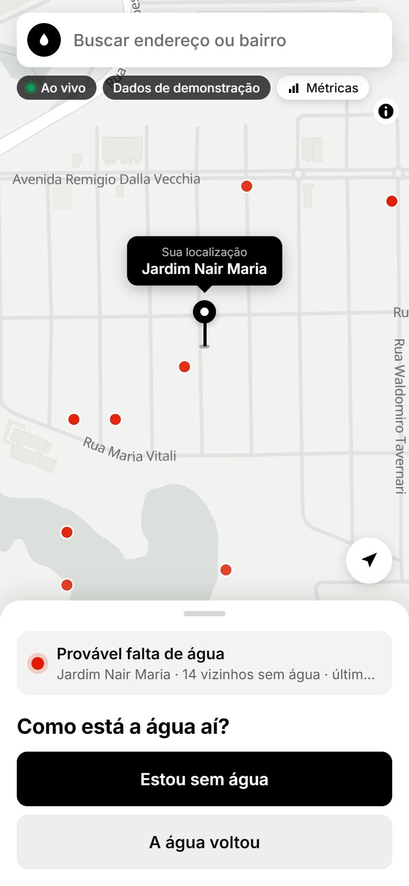
&nbsp;
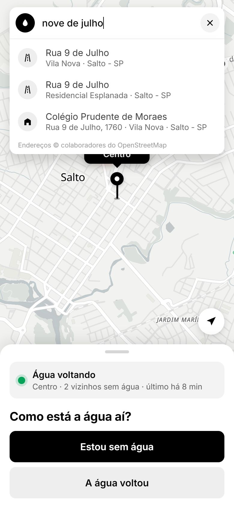
&nbsp;
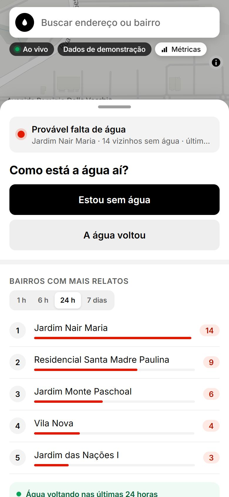

</div>

---

## 🚰 O problema

Em Salto, faltar água virou rotina — e **ninguém avisa antes**.

- 📅 **31/12/2025** — a prefeitura decretou **emergência hídrica**: rodízio de 24 h com água e 24 h sem, e 15 caminhões-pipa nas ruas.
- 🌊 **16/10/2026** — uma enchente parou a estação de tratamento e deixou **~15% da cidade sem água**, sem previsão de volta.
- 📱 O aviso oficial sai num post de rede social. Na prática, o morador **só descobre quando a torneira seca**.

O **Tem Água?** transforma cada morador num sensor: quem está sem água marca no mapa, e todo mundo vê em tempo real onde está faltando — e onde já voltou.

> 📄 A pesquisa que motivou o produto está em [`pesquisa-problemas-salto.md`](pesquisa-problemas-salto.md).

## 👆 Como funciona

| 1. Ache seu lugar | 2. Conte como está | 3. Veja a cidade ao vivo |
|:---:|:---:|:---:|
| Arraste o mapa **ou o pin**, toque em 📍 para usar o GPS ou digite um endereço. | Toque em **"Estou sem água"** ou **"A água voltou"**. Só isso: sem cadastro. | Os pontos aparecem **na hora** no celular e no computador de todos. |

<div align="center">
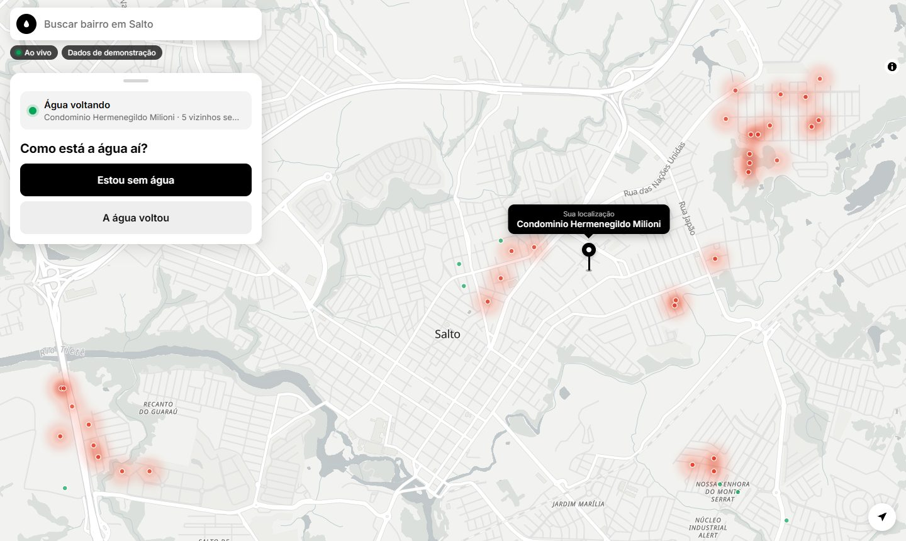
</div>

## ✨ Recursos

### Para quem mora em Salto

| | |
|---|---|
| 🗺️ **Mapa estilo Uber** | Tela cheia e pin central com o nome do bairro. No celular, um painel que sobe de baixo; no computador, uma barra lateral |
| 🔎 **Busca de endereço** | Autocompletar como no Google Maps: ruas, lugares e os 91 bairros de Salto. Entende "nove de julho" como "9 de Julho" e lembra as buscas recentes |
| 📍 **GPS de verdade** | Ponto azul com círculo de precisão; avisa se a permissão foi negada, se o sinal está fraco ou se você está fora de Salto |
| ⚡ **Tempo real** | Relatou no celular, aparece no computador em ~1 s. Caiu a conexão? O relato espera e é reenviado sozinho |
| 🔥 **Mapa de calor** | Manchas vermelhas mostram onde a falta se concentra; relatos recentes pesam mais |
| 🛢️ **Reservatórios** | Liga no mapa as áreas atendidas por cada reservatório, uma cor por setor. O painel mostra qual setor abastece o seu ponto e avisa quando a falta se espalha pelo setor, sinal de problema no reservatório e não na rua ([detalhes](#️-reservatórios-por-região)) |
| 🏆 **Ranking** | Bairros ou reservatórios com mais relatos na última hora, 6 h, 24 h ou 7 dias, e onde a água está voltando |
| 📲 **Instala como app** | PWA com ícone na tela inicial, splash screen e atalhos para as métricas e o monitoramento |

### Para quem acompanha a cidade (imprensa, associações de bairro, prefeitura)

<table>
<tr>
<td width="50%" valign="top">

**📊 Painel de métricas** — em `/metricas` (tela grande)

Indicadores com comparação ao período anterior, relatos por hora e por dia, "quando falta água" (dia da semana × hora), bairros mais afetados e mapa por área. Filtra por período e bairro, atualiza sozinho, **exporta CSV** e gera um **relatório em PDF** de 3 páginas. Abre só em tela grande (computador, notebook ou TV, a partir de 1024 px); no celular aparece um aviso com o link para abrir no computador.

</td>
<td width="50%" valign="top">

**📺 Modo monitoramento** — em `/metricas?modo=monitor`

O mapa de calor em tela cheia, para deixar numa TV. As manchas de falta (vermelho) e de volta da água (verde) pulsam em tempos alternados, e cada relato novo pisca no instante em que chega. Dá para mostrar os setores de abastecimento e acompanhar só alguns deles. A tela não apaga sozinha.

</td>
</tr>
<tr>
<td>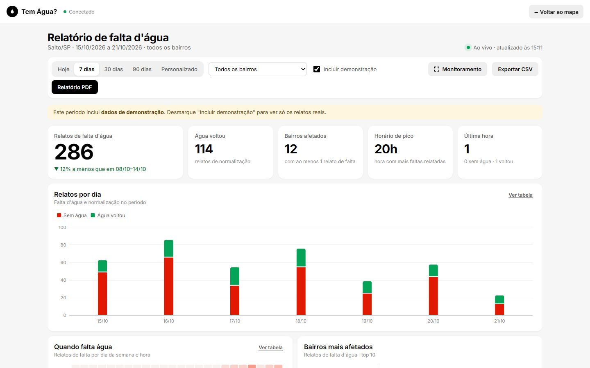</td>
<td>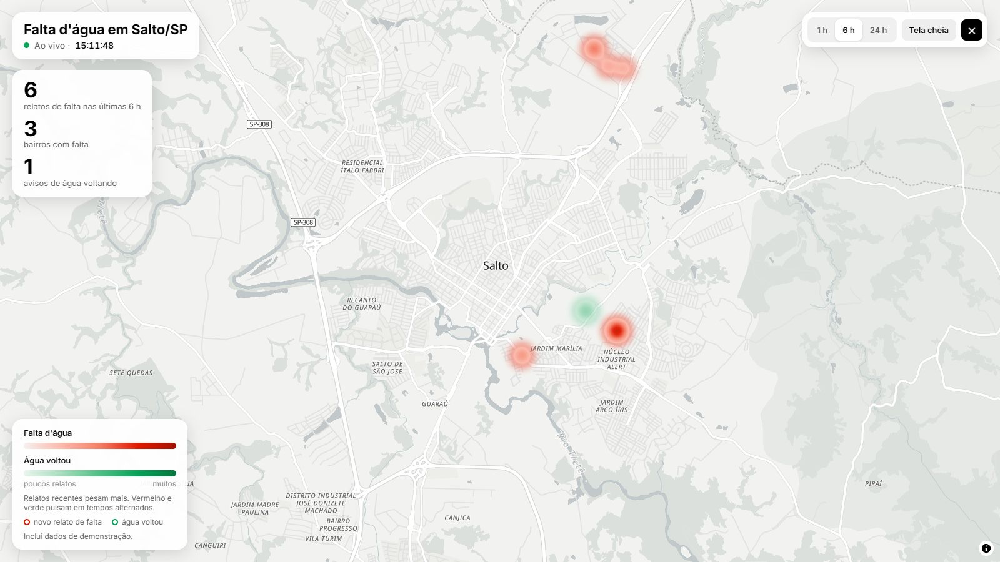</td>
</tr>
</table>

### Por baixo dos panos

| | |
|---|---|
| ⏱️ **Aviso com prazo** | O aviso fica 12 h no mapa e vai perdendo força. Avisar de novo renova; "a água voltou" encerra o aviso anterior. Depois de 4 h o app pergunta "Ainda sem água?" |
| 🔒 **Privacidade** | Sem cadastro e sem endereço. A posição exata fica no aparelho; o servidor só recebe e guarda a posição arredondada (~11 m) |
| 🗄️ **Dados para análise** | Cada relato vira uma linha no PostgreSQL + PostGIS com dia, hora (fuso de Salto) e coordenadas |
| 🔍 **Encontrável no Google** | Uma página por bairro ("falta de água no Jardim Nair Maria"), sitemap, Open Graph para links no WhatsApp |
| 🛡️ **Um aviso por aparelho** | Cada aparelho tem um aviso ativo por vez: ninguém infla o ranking repetindo o botão. O servidor guarda só um código embaralhado do aparelho e o apaga após 30 dias. Só aceita pontos dentro de Salto |

## 🛢️ Reservatórios por região

A água de Salto chega às casas por **26 setores de abastecimento**: cada centro de reservação atende um conjunto de bairros. O Tem Água? cruza os relatos com esses setores e responde a pergunta que o morador não consegue responder sozinho:

> **A falta é na minha rua ou no reservatório?** Se vários bairros do mesmo setor ficam sem água ao mesmo tempo, o problema provavelmente está no reservatório que abastece todos eles.

<div align="center">
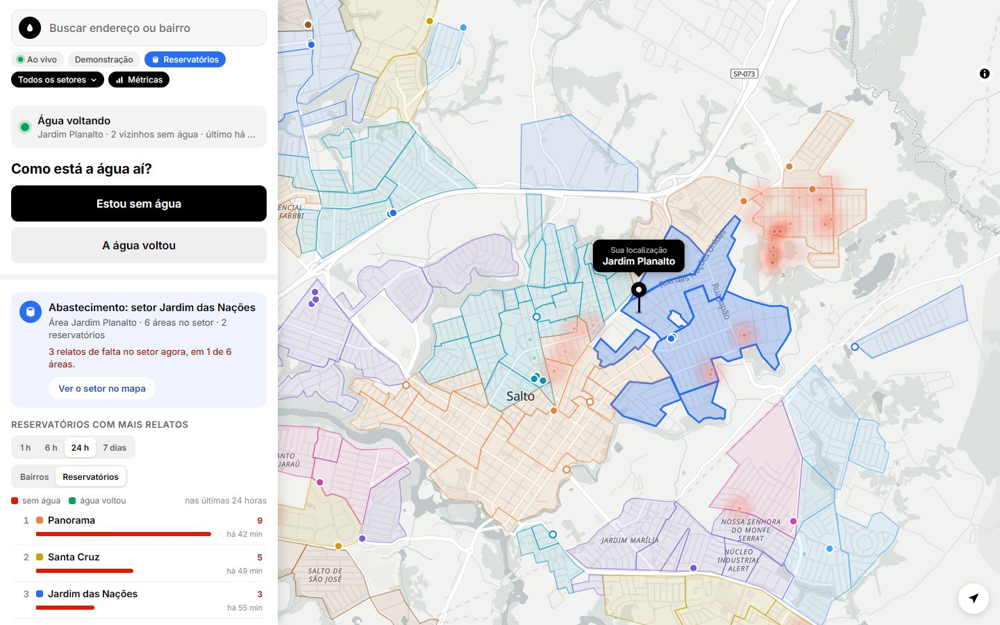
<br/><br/>
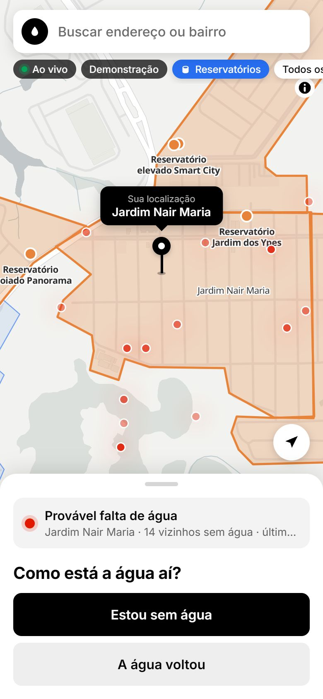
&nbsp;
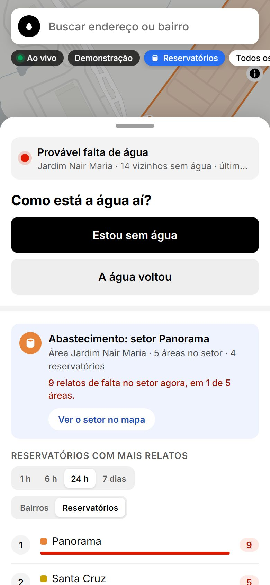
&nbsp;
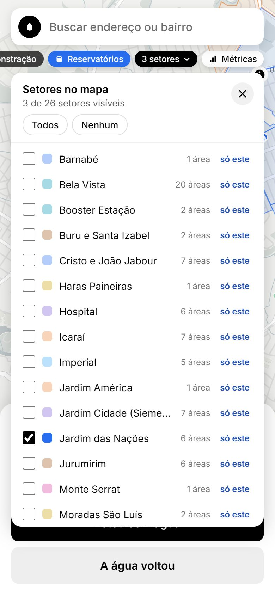
</div>

| Onde | O que mostra |
|---|---|
| 🗺️ **Mapa** | Toque no selo **Reservatórios** para ver as áreas de cada setor, uma cor por setor, com os reservatórios (círculo cheio) e os boosters de bombeamento (círculo vazado). O setor onde está o pin fica realçado; tocar num reservatório mostra o nome dele |
| 🎚️ **Escolher setores** | O selo ao lado (**Todos os setores ▾**) abre a lista dos 26 setores: marque um, dois, três… ou use **só este**, **Todos** e **Nenhum**. O mapa mostra só os escolhidos e se enquadra neles; a escolha fica guardada no aparelho |
| 💧 **Painel** | O cartão **Abastecimento** diz qual setor atende o ponto do pin, quantas áreas e reservatórios ele tem e quantos relatos de falta há no setor agora. Quando a falta aparece em várias áreas do mesmo setor, avisa: *pode ser no reservatório, não só na sua rua* |
| 🏆 **Ranking** | Agrupe por **Bairros** ou por **Reservatórios** para ver quais setores têm mais relatos de falta no período |
| 📺 **Monitoramento** | No mapa de calor em tela cheia, o botão **Setores** mostra o contorno e o nome de cada setor. Escolhendo setores, o calor e os números contam só os relatos deles, e o link guarda a escolha (`/metricas?modo=monitor&setores=panorama,santa-cruz`) para deixar uma TV acompanhando só uma região |
| 📊 **Métricas** | O card **Por reservatório** mostra os relatos de falta por setor e em quantas das suas áreas apareceram, em gráfico e tabela |
| 🔍 **Google** | Cada página de bairro diz qual reservatório abastece o bairro e quais outras áreas dividem o mesmo setor |

<div align="center">
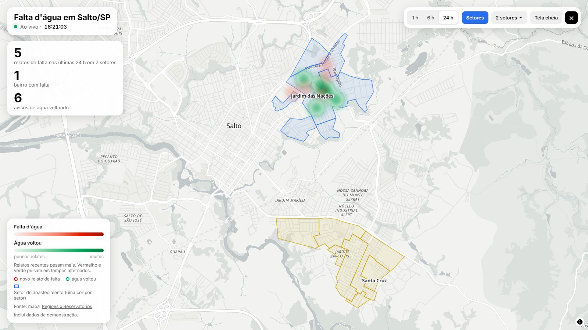
<br/>
<sub>Monitoramento numa TV acompanhando só dois setores: <code>/metricas?modo=monitor&amp;setores=santa-cruz,jardim-das-nacoes</code></sub>
</div>

**Sobre os dados**

- **Origem:** o mapa público [Regiões x Reservatórios](https://www.google.com/maps/d/viewer?mid=1AOlAX-928WBFPFp75o7oMY4K_aIG6bk), com 26 setores, 121 áreas e 42 estruturas (reservatórios elevados e apoiados, boosters e um sistema pressurizado). Os dados ficam no próprio projeto ([`abastecimento.json`](tem-agua/packages/contracts/src/abastecimento.json)): o app não depende do Google para funcionar. Quando o mapa mudar, atualize com:

  ```bash
  npm run abastecimento:importar
  ```

- **Cores:** 26 cores diferentes seriam impossíveis de distinguir. Por isso são 8 cores, distribuídas de forma que setores vizinhos nunca tenham a mesma cor nem cores que se confundem, inclusive para quem tem daltonismo. Vermelho e verde ficam de fora porque no mapa já querem dizer "sem água" e "água voltou". O nome de cada setor aparece no mapa, e a cor se repete no ranking e na tabela das métricas.
- **Cobertura:** chácaras, zona rural e alguns distritos industriais não aparecem no mapa original. Dos 91 bairros do app, 22 ficam fora das áreas. Os contornos foram desenhados à mão e deixam vãos nas ruas: quando o pin cai num vão, o painel mostra o setor da área mais próxima (até 300 m) como "provavelmente setor X".

## 🚀 Rode em 1 minuto

**Só com Docker** (não precisa de Node):

```bash
git clone https://github.com/victorandrad/temagua.app.git
cd temagua.app
docker compose up -d --build
```

Abra **http://localhost:8080**. As métricas ficam em **http://localhost:8080/metricas**. Para parar: `docker compose down` (os relatos ficam salvos).

**Para desenvolver** (Node 20.19+ e Docker, que roda o banco):

```bash
npm run dev
```

Abra **http://localhost:4200**. O primeiro `npm run dev` instala as dependências e sobe o banco sozinho.

| Comando | Para quê |
|---|---|
| `npm run dev` | Sobe tudo para desenvolver (banco + API + mapa + painel + métricas + shell) |
| `npm run dev:ngrok` | O mesmo **+ link HTTPS público** para abrir no celular, com GPS — [como configurar](tem-agua/README.md#testar-no-celular-com-gps) |
| `npm run dev:tunnel` | O mesmo com cloudflared, sem precisar de conta |
| `npm run stop` | Derruba tudo |
| `npm run abastecimento:importar` | Baixa de novo o mapa de reservatórios e atualiza os setores |
| `npm run docker:up` / `docker:down` | Sobe/para a versão Docker (`docker:ngrok` e `docker:tunnel` incluem o link público) |

> 🪟 No Windows dá para usar dois cliques: **`iniciar.cmd`** e **`parar.cmd`**.

## 🧩 Por dentro: três frameworks, um app

Cada pedaço da tela é um **microfrontend** em um framework diferente, costurados em tempo de execução com **Module Federation**. Eles não se conhecem: conversam por um barramento de eventos tipado.

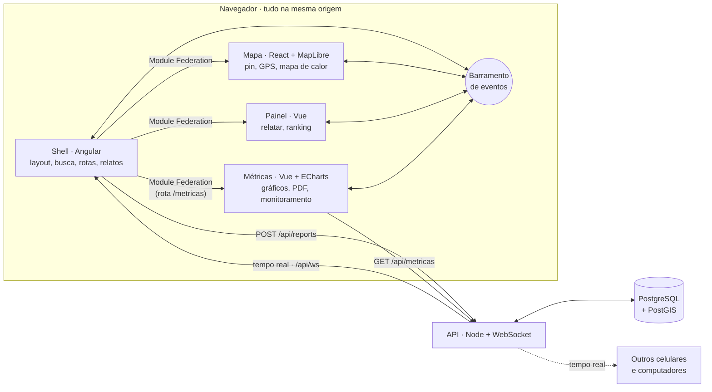

| Pasta | O que é | Stack |
|---|---|---|
| [`tem-agua/apps/shell`](tem-agua/apps/shell) | Casca do app: layout, busca, rotas, dono dos relatos | Angular 21 · signals · zoneless |
| [`tem-agua/apps/mapa`](tem-agua/apps/mapa) | Mapa, pin arrastável, GPS, mapa de calor | React 19 · MapLibre GL 6 |
| [`tem-agua/apps/painel`](tem-agua/apps/painel) | Painel para relatar e ranking | Vue 3 |
| [`tem-agua/apps/metricas`](tem-agua/apps/metricas) | Métricas, relatório PDF e modo monitoramento | Vue 3 · ECharts · MapLibre |
| [`tem-agua/apps/api`](tem-agua/apps/api) | Relatos em tempo real, métricas (inclusive por reservatório), CSV, busca de endereço e páginas para o Google | Node · ws · pg |
| `db` ([`compose.yaml`](compose.yaml)) | Relatos por dia, hora e coordenadas | PostgreSQL 18 · PostGIS 3.6 |
| [`tem-agua/packages/contracts`](tem-agua/packages/contracts) | Tipos, eventos e bairros compartilhados | TypeScript |
| [`tem-agua/docker`](tem-agua/docker) | Imagens da API e do site (Nginx) | Docker |
| [`tem-agua/scripts`](tem-agua/scripts) | Sobe, para e abre túneis com um comando | Node |

Cada remoto expõe só uma função — `mount(elemento) → desmontar` — então o shell não sabe (nem precisa saber) se do outro lado tem React ou Vue. Se um deles falhar, só aquele pedaço da tela mostra "Tentar de novo".

## 🛣️ Próximos passos

- [x] Mapa colaborativo com relatos em tempo real
- [x] GPS, busca de endereços com autocompletar e ranking por período
- [x] Link público para testar no celular (ngrok / cloudflared)
- [x] Banco de dados (PostgreSQL + PostGIS), painel de métricas, CSV e relatório PDF
- [x] Modo monitoramento para TV
- [x] Infra em Docker (Nginx + API + banco, túnel opcional)
- [x] PWA, splash screen e páginas de bairro para o Google
- [x] Reservatórios por região: setores no mapa (com filtro de setores), no painel, no ranking, nas métricas e no monitoramento
- [x] No ar em [saltotemagua.victorandra.de](https://saltotemagua.victorandra.de), com deploy automático a cada push no `main` (GitHub Actions → VPS)
- [ ] Cadastro no Google Search Console
- [ ] Validar com moradores dos bairros mais afetados

## 📚 Documentação

| Para… | Leia |
|---|---|
| Arquitetura, banco, Docker, SEO e deploy em detalhe | [`tem-agua/README.md`](tem-agua/README.md) |
| Trabalhar no código com IA (Claude Code, Codex, Cursor…) | [`AGENTS.md`](AGENTS.md) |
| Entender por que este produto existe | [`pesquisa-problemas-salto.md`](pesquisa-problemas-salto.md) |

---

<div align="center">

Feito em **Salto/SP** 💧 por quem também já ficou sem água.

<sub>Mapa: © <a href="https://openfreemap.org">OpenFreeMap</a> · © <a href="https://www.openmaptiles.org/">OpenMapTiles</a> · dados © colaboradores do <a href="https://www.openstreetmap.org/copyright">OpenStreetMap</a> · setores de abastecimento: mapa <a href="https://www.google.com/maps/d/viewer?mid=1AOlAX-928WBFPFp75o7oMY4K_aIG6bk">Regiões x Reservatórios</a> · busca de endereços: <a href="https://photon.komoot.io">Photon</a></sub>

</div>
