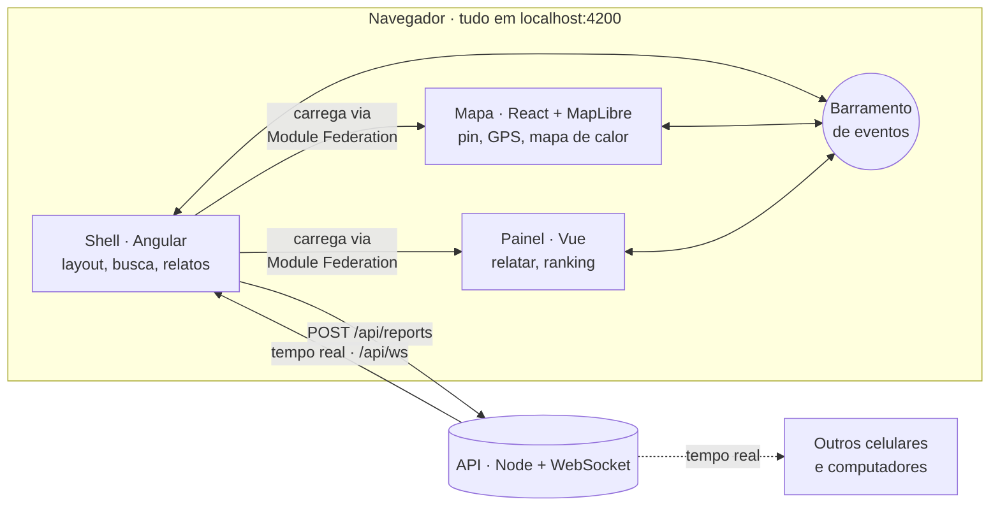

<div align="center">

# 💧 Tem Água?

### O mapa colaborativo da falta d'água em Salto/SP

**Abriu a torneira e não saiu nada? Marque no mapa.**<br/>
Seus vizinhos veem na hora — e você descobre se o problema é só na sua casa ou no bairro inteiro.


<br/>


&nbsp;&nbsp;&nbsp;


</div>

---

## 🚰 O problema

Em Salto, faltar água virou rotina — e **ninguém avisa antes**.

- 📅 **31/12/2025** — a prefeitura decretou **emergência hídrica**: rodízio de 24 h com água e 24 h sem, e 15 caminhões-pipa nas ruas.
- 🌊 **16/10/2026** — uma enchente parou a estação de tratamento e deixou **~15% da cidade sem água**, sem previsão de volta.
- 📱 O aviso oficial sai num post de rede social. Na prática, o morador **só descobre quando a torneira seca**.

O **Tem Água?** transforma cada morador num sensor: quem está sem água marca no mapa, e todo mundo vê em tempo real onde está faltando — e onde já voltou.

> 📄 A pesquisa completa que motivou o produto está em [`pesquisa-problemas-salto.md`](pesquisa-problemas-salto.md).

## 👆 Como funciona

| 1. Ache seu lugar | 2. Conte como está | 3. Veja a cidade ao vivo |
|:---:|:---:|:---:|
| Arraste o mapa **ou o pin**, toque em 📍 para usar o GPS ou busque o bairro. | Toque em **"Estou sem água"** ou **"A água voltou"**. Só isso: sem cadastro. | Os pontos aparecem **na hora** no celular e no computador de todos. |

<div align="center">

</div>

## ✨ O que já funciona

| | |
|---|---|
| 🗺️ **Mapa estilo Uber** | Tela cheia, pin central com o nome do bairro, painel deslizante que se adapta a celular e desktop |
| 📍 **GPS de verdade** | Ponto azul com círculo de precisão; avisa se a permissão foi negada, se o sinal está fraco ou se você está fora de Salto |
| ⚡ **Tempo real** | Relatou no celular, aparece no computador em ~1 s (WebSocket). Caiu a conexão? O relato espera e é reenviado sozinho |
| 🔥 **Mapa de calor** | Manchas vermelhas mostram onde a falta d'água se concentra; relatos recentes pesam mais |
| 🏆 **Ranking de bairros** | Os bairros com mais relatos nas últimas 6 h, a um toque de distância |
| 🔎 **Busca de bairros** | 91 bairros de Salto, com ou sem acento |
| 🔒 **Privacidade** | Sem cadastro e sem endereço: o servidor só recebe a posição arredondada (~10 m) |

## 🚀 Rode em 1 minuto

Você só precisa do **Node 20.19+**.

```bash
git clone https://github.com/victorandrad/temagua.app.git
cd temagua.app
npm run dev
```

Abra **http://localhost:4200** — pronto. O primeiro `npm run dev` instala as dependências sozinho.

| Comando | Para quê |
|---|---|
| `npm run dev` | Sobe tudo (API + mapa + painel + shell) |
| `npm run dev:ngrok` | Sobe tudo **+ link HTTPS público** para abrir no celular (com GPS) — [como configurar](tem-agua/README.md#testar-no-celular-com-gps) |
| `npm run dev:tunnel` | O mesmo com cloudflared, sem precisar de conta |
| `npm run stop` | Derruba tudo |

> 🪟 No Windows, dá para usar só dois cliques: **`iniciar.cmd`** e **`parar.cmd`**.

## 🧩 Por dentro: três frameworks, um app

Cada pedaço da tela é um **microfrontend** em um framework diferente, costurados em tempo de execução com **Module Federation**. Eles não se conhecem: conversam por um barramento de eventos tipado.



| Pasta | O que é | Stack |
|---|---|---|
| [`tem-agua/apps/shell`](tem-agua/apps/shell) | Casca do app: layout, busca, dono dos relatos | Angular 21 · signals · zoneless |
| [`tem-agua/apps/mapa`](tem-agua/apps/mapa) | Mapa, pin arrastável, GPS, mapa de calor | React 19 · MapLibre GL 6 |
| [`tem-agua/apps/painel`](tem-agua/apps/painel) | Painel para relatar e ranking | Vue 3 |
| [`tem-agua/apps/api`](tem-agua/apps/api) | Recebe e distribui relatos em tempo real | Node · ws |
| [`tem-agua/packages/contracts`](tem-agua/packages/contracts) | Tipos, eventos e bairros compartilhados | TypeScript |
| [`tem-agua/scripts`](tem-agua/scripts) | Sobe, para e abre túneis com um comando | Node |

Cada remoto expõe só uma função — `mount(elemento) → desmontar` — então o shell não sabe (nem precisa saber) se do outro lado tem React ou Vue. Se um deles falhar, só aquele pedaço da tela mostra "Tentar de novo".

## 🛣️ Próximos passos

- [x] Mapa colaborativo com relatos em tempo real
- [x] GPS, busca de bairros e ranking
- [x] Link público para testar no celular (ngrok / cloudflared)
- [ ] Banco de dados de verdade no lugar do arquivo JSON (ex.: Postgres/PostGIS ou Supabase)
- [ ] Deploy com endereço fixo
- [ ] Validar com moradores dos bairros mais afetados

## 📚 Documentação

| Para… | Leia |
|---|---|
| Entender a arquitetura, o deploy e as decisões técnicas | [`tem-agua/README.md`](tem-agua/README.md) |
| Trabalhar no código com IA (Claude Code, Codex, Cursor…) | [`AGENTS.md`](AGENTS.md) |
| Entender por que este produto existe | [`pesquisa-problemas-salto.md`](pesquisa-problemas-salto.md) |

---

<div align="center">

Feito em **Salto/SP** 💧 por quem também já ficou sem água.

<sub>Mapa: © <a href="https://openfreemap.org">OpenFreeMap</a> · © <a href="https://www.openmaptiles.org/">OpenMapTiles</a> · dados © colaboradores do <a href="https://www.openstreetmap.org/copyright">OpenStreetMap</a></sub>

</div>
